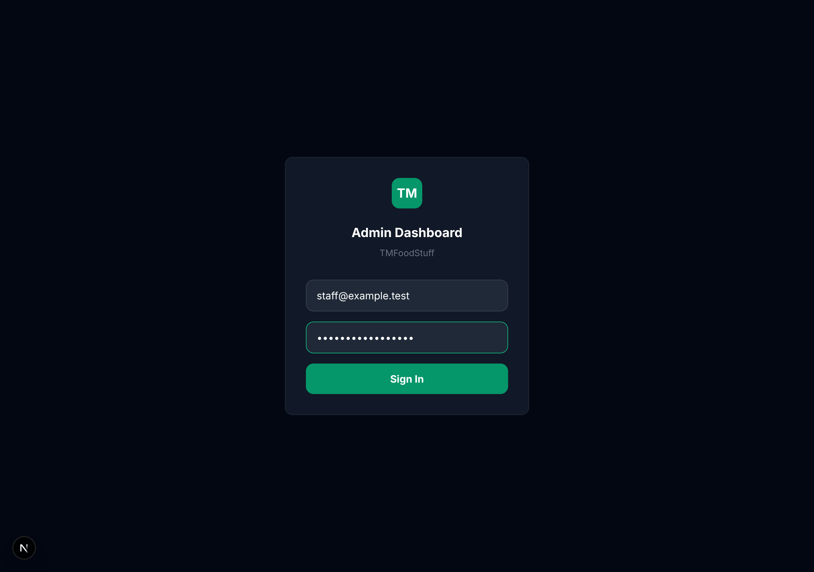
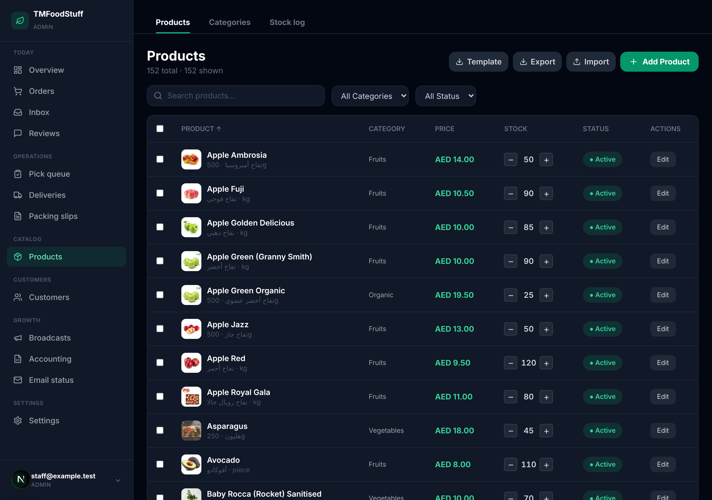
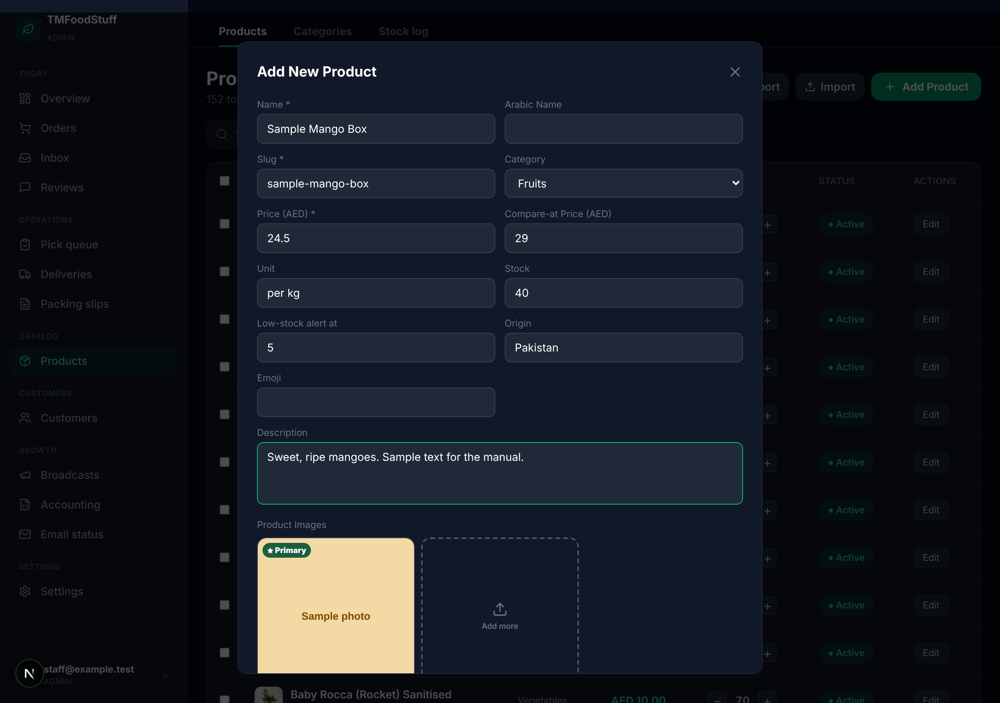
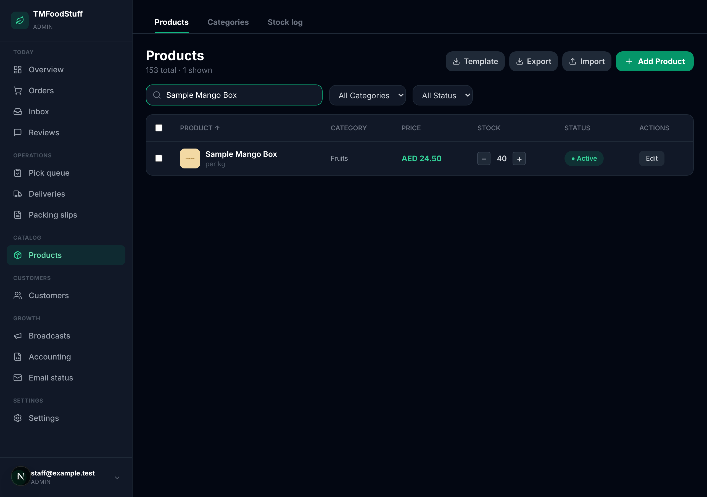
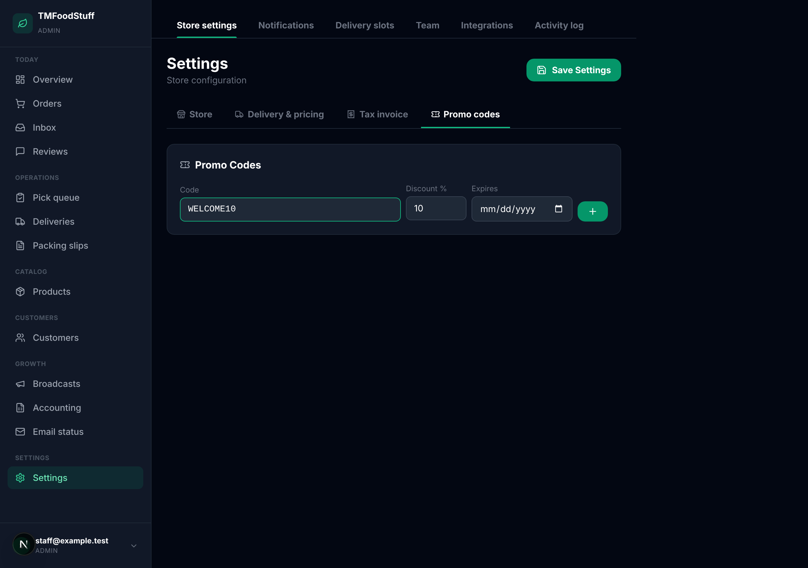
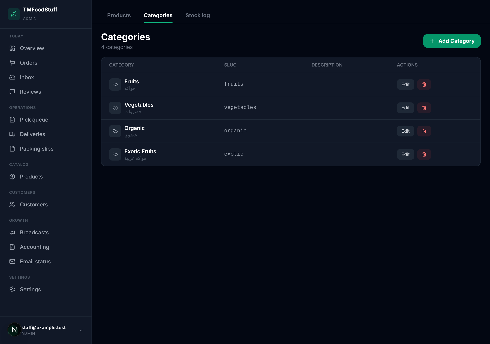
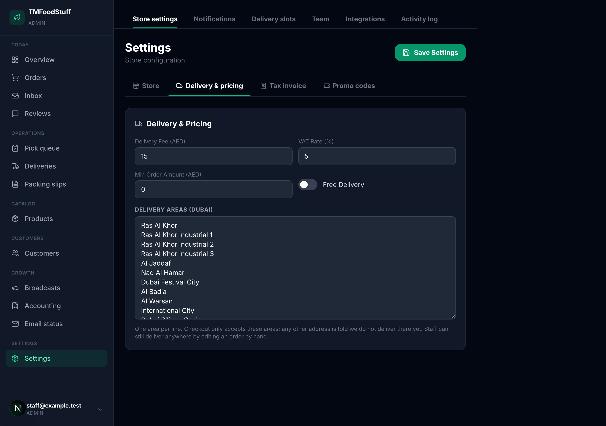

# TMFoodStuff dashboard: staff guide

How to add and change products, run promotions and change where we deliver. Every picture in this guide comes from a practice copy of the dashboard with sample data. Your real dashboard shows your real products.

Open the dashboard at your site address followed by `/dashboard`. Prices are in AED.

## 1. Sign in

1. Go to `/dashboard` on the store website. You land on the sign-in page.
2. Type your email and password, then press the sign-in button.
3. If you see "Access denied", your email has not been added to the staff list yet. Ask an administrator to add it.

## 2. Find your way around

The menu on the left has Products, Orders, Customers and Settings. Open **Products** to see every item in the shop. At the top of the list you can search by name, filter by category, or filter by Active and Inactive.

## 3. Add a product

1. Open **Products** and press the green **Add Product** button at the top right.
2. Fill in the form:
   - **Name** is required. The Slug (the web address of the product) fills in by itself from the name.
   - **Category**: pick one from the list. Add new categories first (section 8).
   - **Price (AED)** is required. This is the price a customer pays for one unit.
   - **Compare-at Price (AED)**: the old, higher price. If you fill it in, the old price shows crossed out beside the new one. Leave it empty for no offer.
   - **Unit** says how the product is sold. Type `per kg` for goods sold by weight, or `per piece`, `per box` or `per bunch` for items sold by count. The unit shows under the product name.
   - **Stock**: how many units you have right now.
   - **Low-stock alert at**: you are warned when stock falls to this number.
   - **Origin**: where the product comes from.
   - **Description**: a few plain sentences for the customer.
3. Add photos (section 4).
4. Press **Add Product** at the bottom of the form. A green "Product created" message appears.

New products are Active, so customers can see them straight away.

## 4. Add or change photos

1. In the form, under **Product Images**, press **Add more**.
2. Choose a picture from your phone or computer. JPG, PNG, WebP and AVIF pictures work, up to 5 MB each. You can add up to 6.
3. The first picture is the main one, marked **Primary**. To make another picture the main one, press **Set Primary** on it. To remove a picture, press the small red cross on it.
4. Press **Save Changes** (when editing) or **Add Product** (when adding).

## 5. Change a price, stock or photo later

1. Open **Products** and type the product name in the search box.
2. Press **Edit** at the end of the row.
3. Change what you need and press the save button at the bottom of the form.

A quick way to change stock: in the products list, press the **minus** or **plus** buttons beside the stock number. Each press changes it by one.

## 6. Show or hide a product

Each row has a status button: **Active** (customers can see and buy it) or **Inactive** (hidden from customers, nothing is deleted).

1. Find the product in the list.
2. Press the status button once to switch between Active and Inactive.

You can also open **Edit**, scroll down and use the **Active** switch.

To change many products at once, tick the boxes on the left of their rows. Buttons appear above the list: **Activate**, **Deactivate**, **Feature**, **Unfeature** and **Delete**. Delete removes a product for good, so use Deactivate if you only want it hidden.

## 7. Promotions and promo codes

There are two ways to run a promotion.

**A sale price on one product.** Open the product with **Edit**, put the normal price in **Compare-at Price (AED)** and the lower sale price in **Price (AED)**, then save. To end the sale, clear the Compare-at Price and put the normal price back.

**A promo code for a percentage off.**

1. Open **Settings** in the left menu, then the **Promo codes** tab.
2. Under **Code**, type the code in capital letters, for example `WELCOME10`.
3. Under **Discount %**, type the percentage, for example `10`.
4. Under **Expires**, pick an end date, or leave it empty for no end date.
5. Press the green **+** button. The code appears in the list above.
6. Press **Save Settings** at the top right. The code does not work until you save.

To stop a code, press **Disable** beside it in the list, then press **Save Settings**.

## 8. Categories

Open **Categories** from the tabs above the products list. Press **Add Category** to make a new one. Press **Edit** on a row to rename it, or the red bin to remove it. Removing a category does not delete its products, but they become uncategorized, so move them to another category first.

## 9. Change the delivery areas

Customers can only order to the areas on this list. Any other address is told we do not deliver there yet.

1. Open **Settings** in the left menu, then the **Delivery & pricing** tab.
2. Find the box called **Delivery areas (Dubai)**.
3. Type one area per line. Delete a line to stop delivering there. Add a new line to start.
4. Press **Save Settings** at the top right. Wait for "Saved!".

On the same tab you can change the **Delivery Fee (AED)** and switch **Free Delivery** on or off.

Staff can still deliver outside the list by editing an order by hand.

## If something goes wrong

- A red message at the top of the products page says what failed. Read it, press the cross to dismiss it, and try again.
- If a product does not show on the shop, check it is Active and has stock.
- If a change does not appear, reload the page and look again.
- Still stuck? Write down what you pressed and what the message said, and send it to the person who set up the site.
